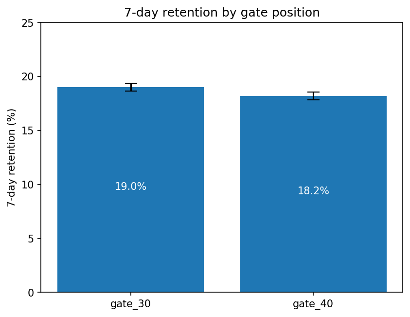
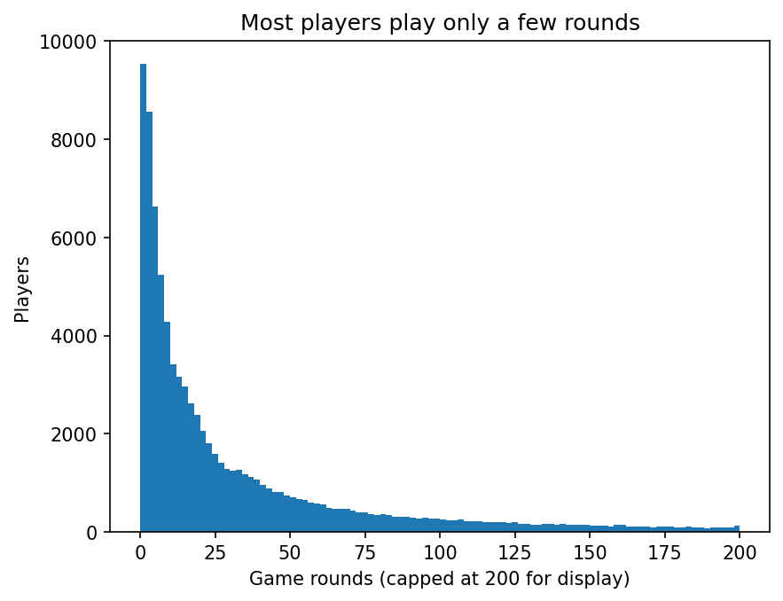
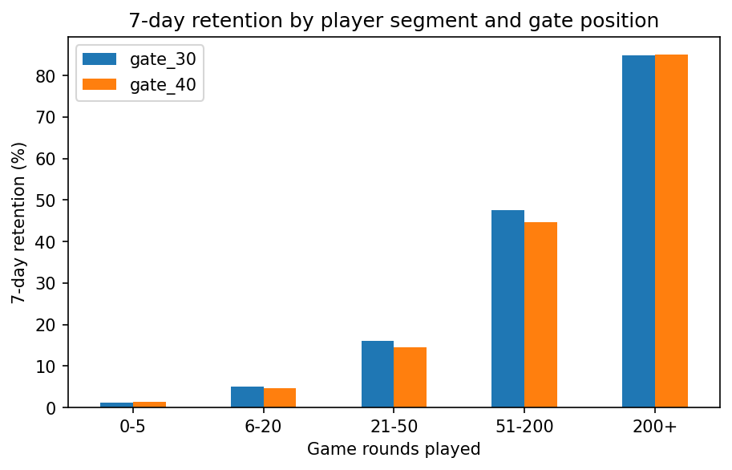

# Cookie Cats A/B Test: Gate Placement and Player Retention

Analysis of an A/B test on the mobile game Cookie Cats (90,189 players): does moving the first progression gate from level 30 to level 40 change player retention?

## Summary

- **Result:** 7-day retention was lower with the gate at level 40 (18.20% vs 19.02%). The difference is 0.82 percentage points (95% CI +0.31 to +1.33, p = 0.0016), a relative drop of about 4.3%. 1-day retention showed no significant difference.
- **Who is affected:** the drop is concentrated among players who played 21 to 200 rounds. Very light and very heavy players show no clear difference (exploratory analysis).
- **Recommendation:** keep the first gate at level 30 and do not roll out level 40.
- **Limitations:** the group split was slightly uneven (49.6% vs 50.4%, p = 0.0086); the data has no revenue; retention is only measured at days 1 and 7; the experiment could reliably detect differences of about 0.74 points or more, so the true effect may be smaller than observed.

## Charts

## Method

1. Data quality checks: missing values, duplicate users, outliers (one player with 49,854 rounds).
2. Sample ratio mismatch check (chi-square test).
3. Two-proportion z-tests with 95% confidence intervals for 1-day and 7-day retention; Bonferroni correction for two metrics.
4. Exploratory segment analysis by rounds played (Bonferroni threshold 0.01).
5. Power and sample size calculation (minimum detectable difference 0.74 points at 80% power).

## Files

- `cookie_cats_ab_test.ipynb`: full analysis with code, results and commentary

## Run it yourself

1. Download the dataset from Kaggle: [Mobile Games A/B Testing - Cookie Cats](https://www.kaggle.com/datasets/mursideyarkin/mobile-games-ab-testing-cookie-cats)
2. Install requirements: `pip install pandas numpy scipy statsmodels matplotlib`
3. Update the file path in the notebook's first data cell and run all cells.

## Tools

Python, pandas, NumPy, SciPy, statsmodels, matplotlib

## Links

- Kaggle notebook: https://www.kaggle.com/code/sangeethakt/cookie-cats-a-b-test

Author: Sangeetha K T
